# 启明学堂 · 教培机构官网 + 教务管理后台

面向中小型教培机构（学科辅导 / 少儿编程 / 语言培训 / 艺术素养）的**前后台一体化系统**：

- **前台官网**（`/`）：课程展示、课程详情与在线报名、师资团队、机构动态、关于我们，另带一套**学员账号**（注册 / 登录 / 个人中心 / 我的报名）。官网内容免登录，学员账号面向家长与学员。
- **管理后台**（`/admin`）：课程上下架、课程分类、师资、报名线索跟进、资讯发布，叠加通用后台底座（用户 / 角色 / 菜单 / 字典 / 日志 / 文件）。登录页固定在 `/admin/login`，前台不提供入口，与学员账号完全隔离。

一句话概括：把「**招生展示 → 在线留资 → 线索跟进 → 课程上下架**」这条教培业务闭环，和一套 RBAC 权限底座做进同一个系统。

> 后台改一门课的价格或上下架状态，前台官网立刻生效；家长在官网提交的报名，实时进入后台线索池 —— 这两条链路是本项目最核心的设计点。

技术栈：Vue3 + Element Plus + Pinia / FastAPI + SQLAlchemy 2.0 + MySQL 8 + Redis 7 + JWT，Docker Compose 一键部署，Nginx 托管静态资源并反代接口。

当前版本：**v2.1.0**

---

## 目录

1. [项目做了什么](#1-项目做了什么)
2. [业务闭环](#2-业务闭环)
3. [功能清单](#3-功能清单)
4. [技术栈](#4-技术栈)
5. [目录结构](#5-目录结构)
6. [快速开始](#6-快速开始)
7. [测试、构建与 CI](#7-测试构建与-ci)
8. [权限模型（RBAC）](#8-权限模型rbac)
9. [主要接口](#9-主要接口)
10. [数据初始化](#10-数据初始化)
11. [安全设计](#11-安全设计)
12. [常见问题](#12-常见问题)
13. [设计要点](#13-设计要点)
14. [后续可扩展](#14-后续可扩展)

---

## 1. 项目做了什么

项目包含三块内容，共用一套后端：

1. **前台官网**：机构对外展示与获客入口。首页聚合统计、课程体系、推荐课程、师资与动态；课程中心支持关键词 / 分类 / 阶段筛选；课程详情页展示价格、课时、大纲、授课教师，并带「预约试听 / 报名」表单。所有数据来自后台，只展示已上架、已发布的内容。官网内容免登录，另提供独立的**学员账号**（注册 / 登录 / 个人中心），登录后报名记录可在「我的报名」查看进度。
2. **教务管理后台**：教培业务操作台。课程 CRUD 与一键上下架、分类与师资维护（被引用时禁止删除）、报名线索按状态流转（待跟进 → 已联系 → 已成交 / 已失效）并支持 Excel 导出、机构动态发布与隐藏。登录入口独立在 `/admin/login`，使用后台账号，不接受学员账号登录。
3. **通用后台底座**：用户 / 角色 / 菜单 / 按钮四级 RBAC、JWT 登录与登出黑名单、数据字典、操作日志（含越权留痕与 Excel 导出）、文件上传与管理、个人中心、首页看板。

---

## 界面预览

> 以下为管理后台 **v2.1.0** 实机截图（1920×960），数据即演示种子数据。

### 教培业务

| 首页看板 · 操作趋势 / 模块分布 / 系统信息 | 课程管理 · 一键上下架 / 首页推荐 / 价格 |
| --- | --- |
| 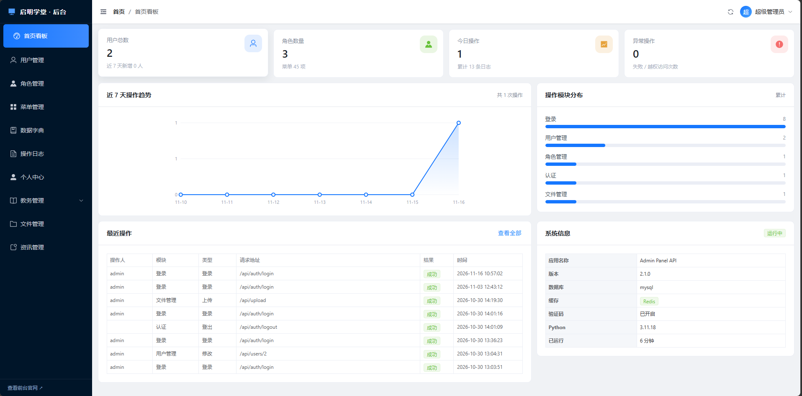 | 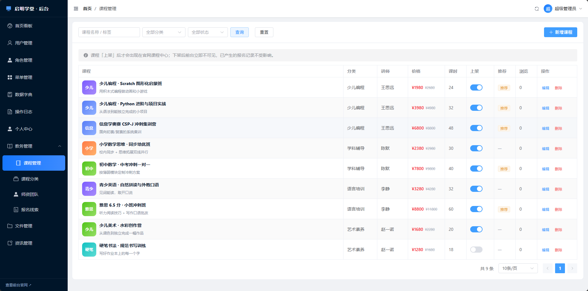 |

| 课程分类 · 被引用禁止删除 | 师资团队 · 教龄 / 标签 / 带课数 |
| --- | --- |
| 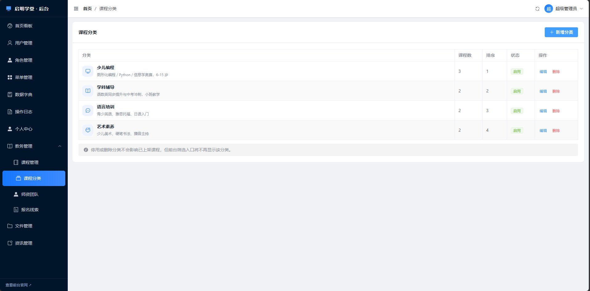 | 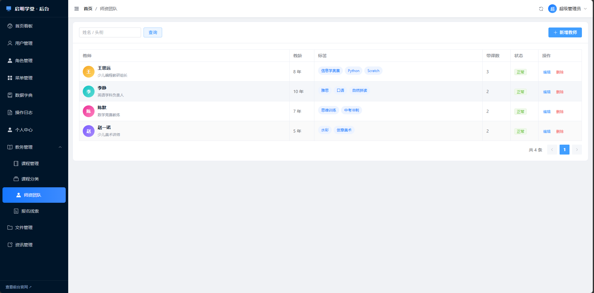 |

| 报名线索 · 状态流转 / Excel 导出 | 资讯管理 · 发布 / 隐藏 |
| --- | --- |
| 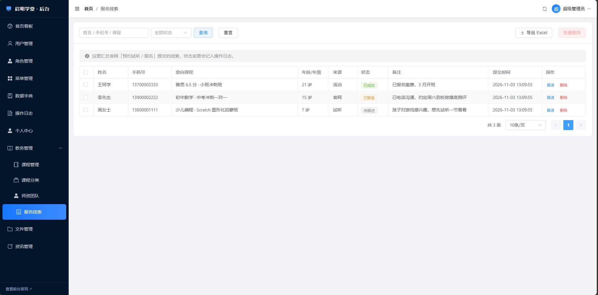 | 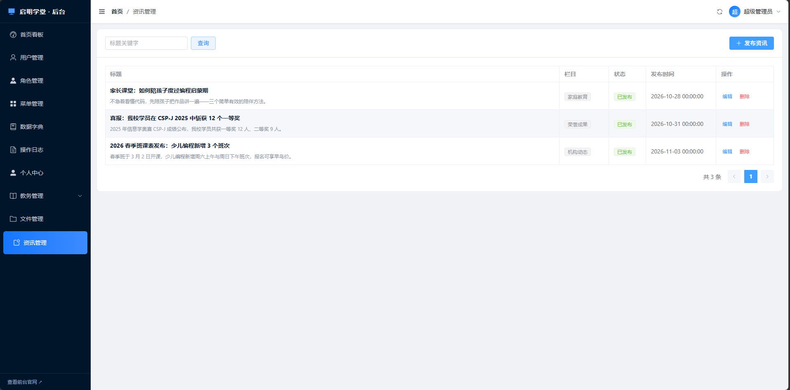 |

### 系统管理

| 用户管理 · 重置密码 / 角色分配 | 角色管理 · 菜单权限分配 |
| --- | --- |
| 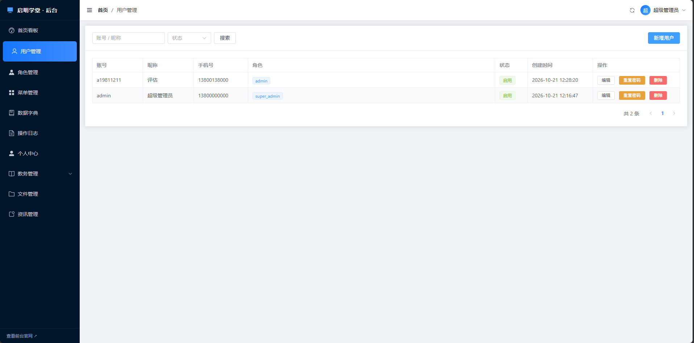 | 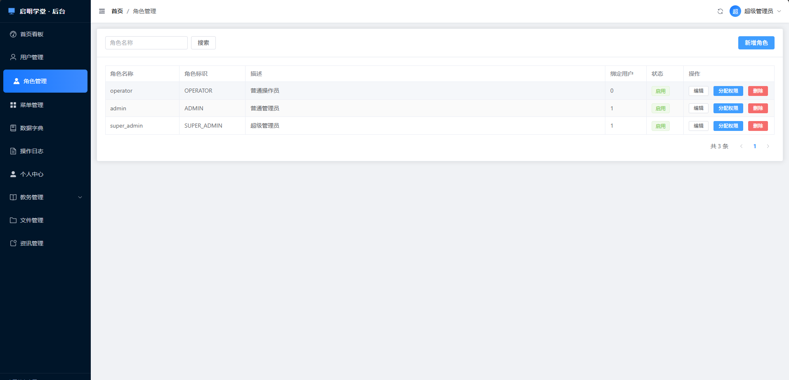 |

| 菜单管理 · 目录 / 页面 / 按钮 | 数据字典 · 字典类型 + 字典项 |
| --- | --- |
| 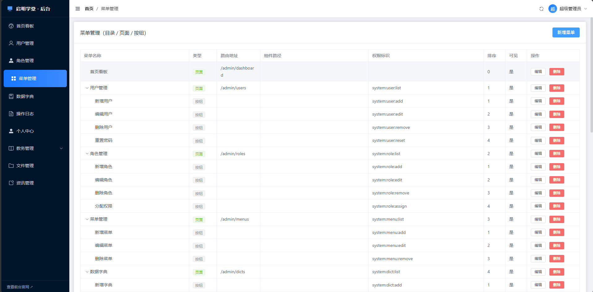 | 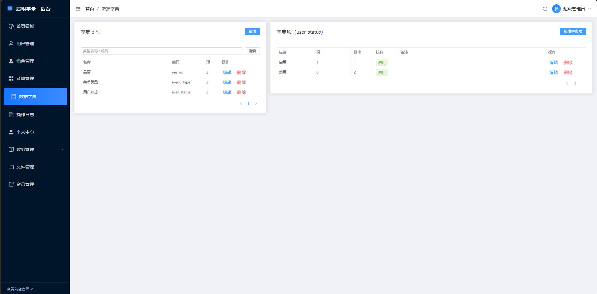 |

| 操作日志 · 只读 / 多维筛选 | 个人中心 · 改密 / 我的日志 |
| --- | --- |
| 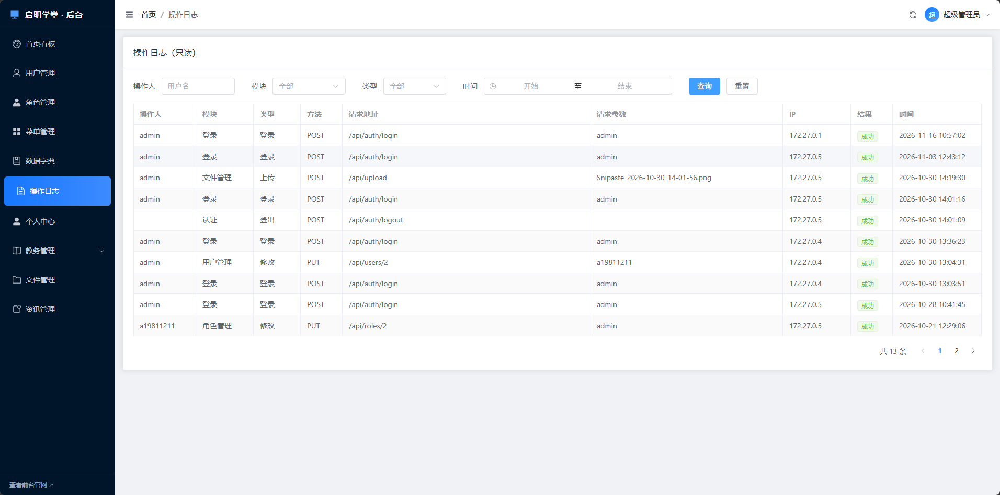 | 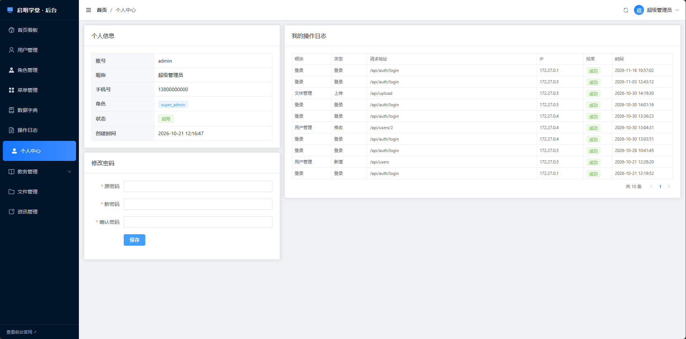 |

| 文件管理 · 上传 / 访问 URL | |
| --- | --- |
| 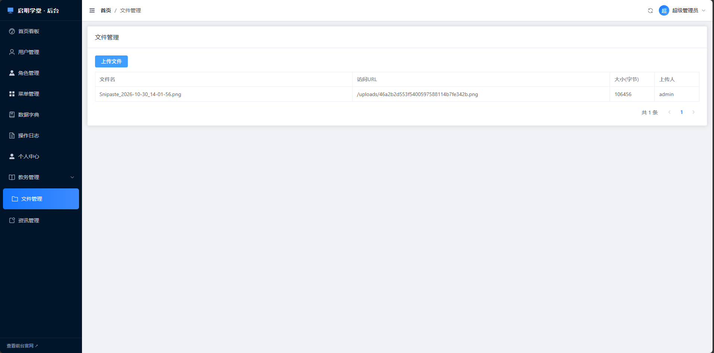 | |

---

## 2. 业务闭环

```
家长访问官网 ──> 课程中心筛选 ──> 课程详情 ──> 提交报名 / 预约试听
                                              │
                                              ▼
                              后台「报名线索」池（待跟进 → 已联系 → 已成交 / 已失效）
                                              │
后台「课程管理」上架/下架课程 ──> 官网课程列表与详情同步变化 ──> 「操作日志」留痕
```

- 前台只查 `status=1`（已上架）且 `is_deleted=0` 的课程，后台改状态后前台**无缓存延迟**。
- 报名提交后写入 `edu_enrollment`，管理端跟进状态并记录备注，所有写操作进入操作日志。
- 同一手机号 + 同一课程 **10 分钟内**重复提交视为重复点击，直接返回成功，避免刷单。

---

## 3. 功能清单

### 3.1 前台官网（免登录）

| 页面 | 能力 |
| --- | --- |
| 首页 | 机构数据统计、课程体系入口、推荐课程、教学优势、师资、机构动态、试听 CTA |
| 课程中心 | 关键词搜索 + 按分类 / 阶段筛选 + 分页（仅展示已上架课程） |
| 课程详情 | 封面、价格与原价、课时周期、标签、适合人群、课程大纲、授课教师、同类课程；右侧固定「预约试听 / 报名」表单 |
| 师资团队 | 教师卡片（教龄、标签、简介）与教学原则 |
| 机构动态 | 资讯列表 + 正文弹窗（仅展示已发布资讯） |
| 关于我们 | 机构介绍、服务流程、校区信息、常见问题 |
| 学员账号 | 注册 / 登录 / 退出；个人中心含「我的报名」（进度与备注）、资料修改、修改密码；登录后报名会自动预填昵称与手机号 |

### 3.2 管理后台（独立登录 + 权限）

| 模块 | 能力 |
| --- | --- |
| 首页看板 | 用户 / 角色 / 日志等计数、近 7 天操作趋势、模块分布、最近操作、运行信息（含缓存模式） |
| 课程管理 | 课程 CRUD、**一键上架 / 下架**（前台同步可见性）、首页推荐、排序、浏览量 |
| 课程分类 | 分类 CRUD；被课程引用时禁止删除；停用后前台筛选入口隐藏 |
| 师资团队 | 教师 CRUD；被课程引用时禁止删除 |
| 报名线索 | 官网线索汇总、按状态 / 关键词筛选、跟进改状态与备注、批量删除、导出 Excel |
| 资讯管理 | 机构动态发布 / 编辑 / 隐藏 / 删除 |
| 系统管理 | 用户（含批量启停、重置密码、导出）、角色、菜单、数据字典、操作日志（筛选 + 导出）、文件管理、个人中心 |

### 3.3 通用能力

- 登录 / 登出（JWT + Redis 黑名单）、图形验证码、登录失败锁定
- 接口级权限校验（`require_perms`）+ 前端路由守卫 + 按钮显隐
- 操作日志：中间件兜底记录全部写操作，端点显式埋点去重，越权访问单独留痕
- 统一响应体 `{code, msg, data}`、统一异常处理、中文参数校验提示
- 文件上传（服务端 uuid 命名 + 扩展名白名单 + 大小限制）
- 列表分页与导出条数上限、接口限流

---

## 4. 技术栈

| 层 | 技术 | 版本 / 说明 |
| --- | --- | --- |
| 前端框架 | Vue 3 + TypeScript | `^3.5.13` / `^5.6.3` |
| UI | Element Plus + Icons | `^2.9.1` / `^2.3.2` |
| 路由 / 状态 | Vue Router + Pinia | `^4.5.0` / `^2.2.6` |
| 请求 | Axios | `^1.7.9` |
| 构建 | Vite + vue-tsc | `^6.0.3` / `^2.1.10` |
| 后端框架 | FastAPI + Pydantic v2 | `0.115.6` / `2.10.4` |
| ORM | SQLAlchemy | `2.0.36` |
| 数据库 | MySQL 8.0（本地 / 容器统一；测试默认临时 SQLite） | `pymysql 1.1.1` |
| 数据库迁移 | Alembic（生产由容器 entrypoint 自动执行） | `1.14.1` |
| 缓存 | Redis 7（不可用时自动降级为进程内存） | `redis 5.2.1` |
| 鉴权 | python-jose(JWT) + passlib/bcrypt | HS256 |
| 导出 | openpyxl | `3.1.5` |
| 可观测性 | Prometheus 指标 + JSON 结构化日志 + 请求 ID | `prometheus-client 0.21.1` |
| 代码质量 | ruff（CI 强制） | `0.9.10` |
| 测试 | pytest + FastAPI TestClient | 30 条用例（SQLite / MySQL 双跑） |
| 部署 | Docker Compose + Nginx（非 root、健康检查、自动迁移） | 4 个服务 |

---

## 5. 目录结构

```
Admin_Panel/
├── backend/
│   ├── app/
│   │   ├── core/             # 配置、数据库、JWT、响应体、验证码、Redis、限流、权限、日志、指标、中间件
│   │   ├── models/models.py  # 15 张表：系统 10 张 + 教培 5 张（唯一 schema 事实来源）
│   │   ├── routers/
│   │   │   ├── api.py        # 系统功能：认证、看板、用户、角色、菜单、字典、日志、文件、个人中心
│   │   │   ├── edu.py        # 教培后台：课程、分类、师资、报名线索、资讯
│   │   │   └── site.py       # 前台官网：首页聚合、课程、师资、资讯、报名（免登录）
│   │   ├── schemas/          # Pydantic 入参校验
│   │   ├── cli.py            # 运维命令：wait-db / create-admin / seed
│   │   └── main.py           # 生命周期、启动策略、内置菜单自愈、种子数据、中间件
│   ├── migrations/           # Alembic 迁移脚本（0001 初始结构 / 0002 查询索引）
│   ├── tests/                # test_api / test_edu / test_ops
│   ├── scripts/              # migrate_sqlite_to_mysql.py：SQLite → MySQL 数据迁移
│   ├── alembic.ini
│   ├── pyproject.toml        # ruff / coverage 工具配置
│   ├── requirements.txt / requirements-dev.txt
│   ├── docker-entrypoint.sh  # 等库 → 迁移 → uvicorn
│   └── Dockerfile            # 多阶段构建、非 root 运行、健康检查
├── frontend/
│   ├── src/
│   │   ├── components/site/  # CourseCard / TeacherCard
│   │   ├── stores/session.ts # Pinia 会话（菜单 + 权限 + 用户）
│   │   ├── utils/            # axios 封装、下载、按钮权限、官网工具（渐变封面等）
│   │   ├── views/
│   │   │   ├── site/         # 官网：Home / Courses / CourseDetail / Teachers / News / About
│   │   │   ├── Courses.vue Categories.vue Teachers.vue Enrollments.vue Articles.vue  # 教培后台
│   │   │   └── Dashboard / Users / Roles / Menus / Dicts / Logs / Files / Profile / Login / Layout
│   │   └── router.ts         # 前台路由 + /admin 后台路由 + 权限守卫
│   ├── vite.config.ts
│   ├── nginx.conf
│   └── Dockerfile
├── mysql/init.sql            # 仅建库；表结构由 Alembic 迁移创建
├── mysql/local-mysql.ps1     # 本机 3307 独立 MySQL 实例的启停脚本
├── nginx/nginx.conf          # 独立部署时的 Nginx 参考配置
├── scripts/                  # 备份脚本（bash 供 Docker / ps1 供本机实例）
├── docs/DEPLOYMENT.md        # 部署、迁移、备份、监控、回滚手册
├── docs/screenshots/         # 管理后台界面截图（见「界面预览」）
├── docker-compose.yml        # mysql / redis / backend / frontend（健康检查 + 日志轮转）
├── Makefile / tasks.ps1      # 常用命令（Linux / Windows）
├── .pre-commit-config.yaml   # 提交前 ruff 检查
├── .env.example              # 环境变量模板
├── .github/workflows/ci.yml  # ruff + 双库测试 + 迁移校验 + 前端构建 + 镜像构建
└── README.md
```

---

## 6. 快速开始

### 6.0 前置要求

| 方式 | 需要 |
| --- | --- |
| Docker 部署（推荐） | Docker Desktop / Docker Engine 20+，含 `docker compose` 子命令 |
| 本地开发 | Python 3.11 / 3.12（与镜像一致）、Node.js 20 LTS、npm 10+ |
| 可选 | 本机 MySQL 8（本地开发必需）、Redis 7（不装会自动降级为内存缓存）；SQLite 仅用于测试 |

### 6.1 方式一：Docker Compose 一键启动（推荐）

```bash
# 1) 复制环境变量模板（按需修改密码、SECRET_KEY、验证码开关等）
cp .env.example .env

# Windows PowerShell 用这条：
Copy-Item .env.example .env

# 2) 构建并启动（首次会拉取镜像、安装依赖，耐心等几分钟）
docker compose up -d --build

# 3) 查看服务状态，mysql / redis 显示 healthy 即就绪
docker compose ps
```

启动后访问：

| 入口 | 地址 |
| --- | --- |
| 前台官网 | http://localhost |
| 学员登录 / 个人中心 | http://localhost/account/login |
| 管理后台（登录页） | http://localhost/admin/login |
| 接口文档（Swagger） | http://localhost:8000/api/docs |
| 健康检查 | http://localhost:8000/api/health |
| MySQL（宿主机） | `127.0.0.1:3307`，库 `admin_panel`，账号见 `.env` |
| Redis | `127.0.0.1:6379` |

**默认账号：`admin / 123456`**（上线前务必修改；新密码要求 ≥8 位且至少含两类字符）。

> 首次启动会：
> - 自动建表（`Base.metadata.create_all`）；
> - 灌入演示数据：4 个分类、4 位教师、9 门课程、3 条资讯、3 条报名线索、5 组字典；
> - 幂等迁移老库菜单路径（统一到 `/admin` 前缀）并补齐新模块。
>
> 重启不会重复灌入，可安全反复 `up`。

常用运维命令：

```bash
docker compose logs -f backend     # 看后端日志
docker compose restart backend     # 只重启后端
docker compose down                # 停止（保留数据卷）
docker compose down -v             # 停止并删除数据卷（清库，下次启动重新灌演示数据）
```

**端口说明**：前端 80、后端 8000、Redis 6379、MySQL 映射到 **3307**（避免与本机已装的 MySQL 3306 冲突）。若 80 被占用，改 `docker-compose.yml` 中 frontend 的 `ports` 即可。本地开发用的 3307 独立实例与这个映射端口相同，**两者不能同时启动**（用 compose 前先 `.\mysql\local-mysql.ps1 stop`）。

### 6.2 方式二：本地开发（不用 Docker）

本地开发连 **MySQL 8**（不再默认用 SQLite），配置放在 `backend/.env`（已被 `.gitignore` 忽略），应用启动时自动读取。

本机使用项目专用的独立 MySQL 实例：**127.0.0.1:3307**，数据目录 `.mysql-3307/`，启停脚本 `mysql/local-mysql.ps1`，与系统里 3306 的 MySQL 服务互不影响。

#### 0) 启动本机 MySQL（3307）

```powershell
.\mysql\local-mysql.ps1 start     # 状态：status；关闭：stop
```

> - 实例已初始化完成（root / admin 密码见 `backend/.env`）。换机器首次初始化见脚本头部注释。
> - Docker 方案的 MySQL 也映射宿主机 3307，两者不能同时启动；用 Docker 前先 `stop`。
> - 不想用这个实例：改 `backend/.env` 里的 `MYSQL_HOST` / `MYSQL_PORT` / `MYSQL_USER` / `MYSQL_PASSWORD` 指向你自己的 MySQL 即可（需先建库：`CREATE DATABASE IF NOT EXISTS admin_panel CHARACTER SET utf8mb4;`）。

#### 后端

```powershell
cd backend

# 建议用虚拟环境（Python 3.11 / 3.12，与镜像一致）
python -m venv .venv
.venv\Scripts\Activate.ps1

pip install -r requirements.txt

# 1) 本地配置：模板已填好 127.0.0.1 / 3307 / admin，把 MYSQL_PASSWORD 改成自己的
Copy-Item .env.example .env

# 2) 建表：开发环境启动时会自动 create_all；也可以走标准迁移（推荐，和线上一致）
alembic upgrade head

# 3) 启动（种子数据、菜单迁移在启动时幂等补齐）
uvicorn app.main:app --reload --port 8000
```

macOS / Linux / Git Bash：

```bash
cd backend
python3 -m venv .venv && source .venv/bin/activate
pip install -r requirements.txt
cp .env.example .env          # 改成自己的 MYSQL_PASSWORD；用不了 ps1 脚本时把 MYSQL_PORT 改成本机 MySQL 端口
alembic upgrade head
uvicorn app.main:app --reload --port 8000
```

- 后端地址：http://localhost:8000 ，接口文档 http://localhost:8000/api/docs（`APP_ENV=prod` 时自动关闭）
- 配置优先级：真实环境变量 > `backend/.env` > 项目根 `.env` > 代码默认值。Docker 部署时仍由 compose 注入，不受 `backend/.env` 影响。
- 本地不装 Redis 也能跑：首次探测失败后自动降级为**进程内存缓存**（`GET /api/ready` 的 `data.cache` 会显示 `memory`）。
- 想看当前到底连的哪个库：访问 `/api/dashboard/overview`，`system.database` 为 `mysql` 即已切到 MySQL。
- 老库（`create_all` 时代）首次接管迁移：先 `alembic stamp 0001_initial`，再 `alembic upgrade head`。

> 从旧版 SQLite 数据升级：在 `backend/` 下执行
> `python scripts/migrate_sqlite_to_mysql.py`（默认读 `local.db`，会重建 MySQL 表并按外键顺序迁数据），
> 再启动一次后端，种子数据与菜单路径迁移会自动补齐。详见 [§10](#10-数据初始化)。
>
> 生产部署（HTTPS、迁移、备份、监控、回滚）见 [docs/DEPLOYMENT.md](docs/DEPLOYMENT.md)。

#### 前端

```bash
cd frontend
npm install
npm run dev
```

- 前端地址：http://localhost:5173
- Vite 已把 `/api` 与 `/uploads` 代理到 `http://localhost:8000`，前后端分别启动即可联调。
- 前台首页：http://localhost:5173 ；学员中心：http://localhost:5173/account ；后台登录：http://localhost:5173/admin/login

#### 两个终端一起跑的最短路径

```powershell
# 终端 1（前提：backend\.env 已按本机 MySQL 配好，见上一节）
cd backend; .venv\Scripts\python.exe -m uvicorn app.main:app --reload --port 8000

# 终端 2
cd frontend; npm run dev
```

### 6.3 启动后 5 分钟自检

1. 打开 http://localhost:8000/api/health ，返回 `code: 200`、`status: ok`；`/api/ready` 返回 `data.database: true`。
2. 打开 http://localhost:8000/api/docs ，能看到 Swagger 接口列表（生产环境默认关闭）。
3. 用 `admin / 123456` 登录后台，进入「课程管理」能看到演示课程。
4. 把某门课点「下架」，回到前台课程中心刷新，该课程消失 —— 验证前后台联动。
5. 在前台课程详情提交一次报名，后台「报名线索」出现新记录 —— 验证线索闭环。
6. 打开「操作日志」，能看到刚才的写操作记录。

### 6.4 环境变量

配置读取自环境变量（`backend/app/core/config.py`），并自动加载 `backend/.env` 与项目根 `.env`（真实环境变量优先）。Docker 部署时由 compose 注入。常用项：

| 变量 | 默认值 | 说明 |
| --- | --- | --- |
| `APP_NAME` / `APP_VERSION` | `Admin Panel API` / `2.1.0` | 应用名与版本号 |
| `APP_ENV` | `dev` | `dev` / `test` / `prod`；**生产必须设 `prod`**（关文档、不灌演示数据、强校验密钥） |
| `SECRET_KEY` | `change-me-super-secret-key` | JWT 签名密钥；生产必须 ≥32 位随机串，否则启动失败 |
| `ALGORITHM` | `HS256` | JWT 算法 |
| `ACCESS_TOKEN_EXPIRE_MINUTES` | `720` | Token 有效期（分钟） |
| `DB_URL` | 空 | 显式数据库连接串（**留空即走下面的 MySQL 配置**）；仅临时用 SQLite 时才填 |
| `MYSQL_HOST` / `MYSQL_PORT` / `MYSQL_USER` / `MYSQL_PASSWORD` / `MYSQL_DB` | `mysql` / `3306` / `admin` / `123456` / `admin_panel` | MySQL 连接信息；本地开发用 `127.0.0.1` / `3307` |
| `REDIS_HOST` / `REDIS_PORT` / `REDIS_DB` | `127.0.0.1` / `6379` / `0` | Redis 连接信息 |
| `REDIS_REQUIRED` | `false` | 多实例生产建议 `true`：Redis 不可用时 `/api/ready` 返回 503 |
| `UPLOAD_DIR` | `/app/uploads` | 上传目录，本地开发建议改为 `./uploads` |
| `MAX_UPLOAD_MB` | `10` | 单文件上传上限 |
| `ALLOWED_EXTS` | `.jpg,.jpeg,.png,.gif,.webp,.pdf,.xls,.xlsx,.doc,.docx,.txt,.zip` | 上传扩展名白名单（逗号分隔） |
| `CORS_ORIGINS` | `*` | 允许跨域来源，生产建议写具体域名 |
| `TRUSTED_HOSTS` | `*` | 允许的 Host 头；生产建议写具体域名 |
| `CAPTCHA_ENABLED` | `true` | 图形验证码开关，本地调试可关 |
| `CACHE_TTL` | `300` | 菜单 / 字典缓存秒数 |
| `PASSWORD_MIN_LEN` / `PASSWORD_MIN_CLASSES` | `8` / `2` | 密码最小长度 / 至少几类字符 |
| `LOGIN_MAX_FAILS` / `LOGIN_LOCK_MINUTES` | `5` / `10` | 登录失败锁定阈值与锁定时长 |
| `RATE_LIMIT_ENABLED` | `true` | 接口限流开关（压测 / 自动化测试可关） |
| `LOG_LEVEL` / `LOG_FORMAT` | `INFO` / `text` | 日志级别；容器化建议 `json` |
| `METRICS_ENABLED` | `true` | 是否暴露 `/metrics` |
| `AUTO_CREATE_TABLES` | 按环境 | `dev`/`test` 自动建表；`prod` 关闭，必须先执行迁移 |
| `SEED_BASE_DATA` | `true` | 幂等补齐角色 / 菜单 / 字典 / admin |
| `SEED_DEMO_DATA` | 按环境 | `dev`/`test` 灌教培演示数据；`prod` 默认关闭 |
| `ADMIN_INITIAL_PASSWORD` | 空 | 生产首启建 admin 用；建好后应清空，或改用 `python -m app.cli create-admin` |
| `WEB_CONCURRENCY` | `2` | 容器内 uvicorn worker 数（建议 = CPU 核数） |

---

## 7. 测试、构建与 CI

```bash
# 后端：30 条用例（默认临时 SQLite，不污染本地库）
cd backend
pip install -r requirements-dev.txt
pytest

# 也可以直接在 MySQL 上跑一遍，验证与线上同款数据库的兼容性
# PowerShell：
$env:TEST_DB_URL="mysql+pymysql://admin:<你的密码>@127.0.0.1:3307/admin_panel_test?charset=utf8mb4"
pytest -q

# 代码规范 / 覆盖率 / 迁移漂移检查
ruff check .
pytest -q --cov=app --cov-report=term-missing
alembic upgrade head && alembic check
```

```bash
# 前端：类型检查 + 生产构建
cd frontend
npm ci
npm run typecheck
npm run build
```

- 测试夹具（`backend/tests/conftest.py`）默认建临时 SQLite 库、关闭验证码与限流、Redis 指向不存在的端口以验证内存降级；设置 `TEST_DB_URL` 时改连专用 MySQL 测试库（会话开始时 DROP 重建，**必须指向专用库**）。
- `npm run build` = `vue-tsc --noEmit && vite build`，产物在 `frontend/dist`。
- GitHub Actions（[`.github/workflows/ci.yml`](.github/workflows/ci.yml)）分四个 job：`ruff` 规范检查、后端 SQLite + MySQL 双库测试与 Alembic 迁移校验、前端构建、后端 / 前端镜像构建校验。
- 本地提交前可执行 `pre-commit install`（配置见 [`.pre-commit-config.yaml`](.pre-commit-config.yaml)），提交时自动跑 ruff。

---

## 8. 权限模型（RBAC）

```
sys_user ──< sys_user_role >── sys_role ──< sys_role_menu >── sys_menu
                                              │
                                    menu_type: M 目录 / C 页面 / F 按钮
                                    perms:     edu:course:list / edu:course:publish ...
```

- 菜单路径统一挂在 `/admin` 下（如 `/admin/courses`），前台路由不受权限系统约束。
- 登录后 `GET /api/auth/menus` 返回菜单树 + 按钮权限；前端据此渲染侧边栏、控制按钮显隐，路由守卫二次校验 `meta.perm`。
- 超级管理员返回 `["*"]`，后端 `require_perms` 直通，前后端口径一致。
- 权限缓存用「版本号 + 前缀」失效：角色菜单 / 用户角色 / 菜单变化时递增版本，避免逐 key 清理遗漏。
- 教培模块权限：`edu:course:*`、`edu:category:*`、`edu:teacher:*`、`edu:enrollment:*`、`edu:article:*`（含 `publish`、`export` 这类动作权限）。

---

## 9. 主要接口

| 方法 | 路径 | 说明 |
| --- | --- | --- |
| GET | `/api/site/home` | 官网首页聚合数据（统计 / 分类 / 推荐 / 师资 / 动态） |
| GET | `/api/site/courses` | 前台课程列表（仅已上架，支持关键词 / 分类 / 阶段 / 分页） |
| GET | `/api/site/courses/{id}` | 前台课程详情（含同类课程，浏览量 +1） |
| GET | `/api/site/teachers`、`/api/site/articles` | 师资 / 资讯（仅已发布） |
| POST | `/api/site/enroll` | 提交报名 / 预约试听（游客可提交；带学员 Token 时归属到账号，含重复提交抑制） |
| POST | `/api/site/auth/register`、`/api/site/auth/login`、`/api/site/auth/logout` | 学员注册 / 登录 / 退出（Token scope=site） |
| GET/PUT | `/api/site/me`、`/api/site/me/password` | 学员资料 / 修改密码 |
| GET | `/api/site/me/enrollments` | 我的报名（按账号归属 + 手机号匹配历史线索） |
| GET/POST/PUT/DELETE | `/api/courses`、`/api/courses/{id}` | 课程管理 |
| PUT | `/api/courses/{id}/status` | 上架 / 下架 |
| GET/POST/PUT/DELETE | `/api/course-categories` | 课程分类 |
| GET/POST/PUT/DELETE | `/api/teachers` | 师资 |
| GET | `/api/enrollments`、`PUT /api/enrollments/{id}` | 报名线索 / 跟进 |
| GET | `/api/enrollments/export` | 报名线索导出 Excel |
| GET/POST/PUT/DELETE | `/api/articles` | 资讯 |
| GET | `/api/auth/captcha` | 获取图形验证码 |
| POST | `/api/auth/login`、`/api/auth/logout` | 登录 / 退出（Token 黑名单） |
| GET | `/api/auth/menus` | 菜单树 + 按钮权限 |
| GET | `/api/dashboard/overview` | 后台首页看板 |
| GET/POST/PUT/DELETE | `/api/users`、`/api/roles`、`/api/menus`、`/api/dict/*` | 系统管理 |
| GET | `/api/logs`、`/api/logs/options`、`/api/logs/export` | 操作日志查询 / 筛选项 / 导出 |
| GET | `/api/health` | 存活探针（不依赖 DB / Redis） |
| GET | `/api/ready` | 就绪探针（检查 DB / 可选 Redis，失败 503） |
| GET | `/metrics` | Prometheus 指标（仅内网，Nginx 公网入口返回 404） |

完整接口与参数以 Swagger（`/api/docs`）为准。

---

## 10. 数据初始化

- **Schema 单一事实来源**：`backend/app/models/models.py`，版本化由 Alembic 管理（`backend/migrations/`）。
- 建库：本地独立实例（`mysql/local-mysql.ps1`，数据目录 `.mysql-3307/`）已建好 `admin_panel` 与 `admin_panel_test`；Docker 由 `MYSQL_DATABASE` 自动建库。
- 建表：容器启动时 entrypoint 执行 `alembic upgrade head`；本地开发可直接 `alembic upgrade head`（开发环境启动时也会自动 `create_all` 兜底）。`mysql/init.sql` 只负责建库，不再维护第二份表结构。
- 基线：老库（没有 `alembic_version`）由 `python -m app.cli migrate` 自动 stamp 初始版本后升级，容器 entrypoint 已内置这一步。
- 种子数据：角色 / 菜单 / 字典由 `_seed_base()` 幂等补齐；管理员首次由 `ADMIN_INITIAL_PASSWORD` 或 `python -m app.cli create-admin` 创建；教培演示数据由 `SEED_DEMO_DATA` 控制（生产默认关闭）。
- 系统表：`sys_user`、`sys_role`、`sys_user_role`、`sys_menu`、`sys_role_menu`、`sys_dict_type`、`sys_dict_item`、`sys_oper_log`、`sys_file`、`biz_data`（旧版演示模块，导航已隐藏）。
- 前台账号表：`site_user`（与 `sys_user` 完全独立）；`edu_enrollment.site_user_id` 记录报名归属的学员账号。
- 教培表：`edu_category`、`edu_teacher`、`edu_course`、`edu_enrollment`、`edu_article`。
- 种子数据全部**幂等**：重复启动不会产生重复数据；老库启动时自动把菜单路径迁移到 `/admin` 并补齐新模块。
- **从 SQLite 切到 MySQL**：`cd backend && python scripts/migrate_sqlite_to_mysql.py`。脚本会确保目标库存在、按 `models.py` 重建表、按外键顺序迁移 `local.db` 的数据；随后启动后端即自动补齐种子数据与菜单路径。

---

## 11. 安全设计

已修复的关键问题：

| 问题 | 处理 |
| --- | --- |
| 上传路径穿越 | 落盘名改为服务端 `uuid + 白名单扩展名`，原始文件名只作展示，落盘路径 realpath 校验 |
| 登出黑名单过期时间偏移 8 小时 | `utcnow().timestamp()` 改为带时区的 `datetime.now(timezone.utc)` |
| 菜单可被设成自己子级导致树断裂 | 更新前检测后代集合，禁止成环 |
| 已删除用户仍可用旧 Token | 鉴权时校验 `is_deleted`，并区分「不存在 / 已禁用」 |
| 超管前端权限标识缺失 | `/auth/menus` 对超管返回 `["*"]` |
| 报名接口刷单 | 同手机号 + 同课程 10 分钟内重复提交只算一次，另有按 IP 限流 |
| 前台 / 后台账号混用 | 两套账号表（`site_user` / `sys_user`）+ JWT `scope`：前台 Token 访问后台接口一律 401，后台 Token 也不能当学员用 |
| 后台入口暴露在官网 | 官网移除「管理后台」链接，后台登录页独立在 `/admin/login`；旧 `/login` 只做兼容重定向 |

其他加固：bcrypt 密码哈希、验证码、登录失败锁定、Pydantic 参数校验中文提示、ORM 防注入、软删除、上传白名单与大小限制、分页上限、导出条数上限、非超管不得操作超管账号、统一错误码与异常兜底。

---

## 12. 常见问题

**Q1：登录页没有验证码输入框？**
本地把 `CAPTCHA_ENABLED` 设成了 `false`（或前端拿不到验证码接口）。生产环境请保持 `true`。

**Q1.1：管理员从哪里进后台？前台还能直接进吗？**
后台登录页固定在 **`/admin/login`**，官网首页 / 导航 / 页脚都不再提供入口，旧 `/login` 只做兼容跳转。学员请走 `/account/login`（或 `/account/register` 注册），两套账号的 Token 互不通用：学员 Token 调后台接口返回 401，管理员 Token 也进不了学员中心。

**Q2：登录成功但进入页面提示 403 / 菜单为空？**
当前账号的角色没有对应权限。用超管给角色分配菜单，或直接使用 `admin`。前端路由守卫会二次校验 `meta.perm`。

**Q3：没有 Redis 能启动吗？**
能。启动时 1 秒探测一次，失败后自动降级为进程内存缓存，`GET /api/ready` 的 `data.cache` 显示 `memory`。单机没问题；多实例部署必须接真实 Redis 并设 `REDIS_REQUIRED=true`，否则限流 / 登录锁定不共享。

**Q4：上传图片报 413？**
Nginx 默认只允许 1MB。项目已把 `client_max_body_size` 调到 12m、后端 `MAX_UPLOAD_MB` 为 10。若仍失败，检查是否改过 Nginx 配置或用了未更新的镜像。

**Q5：宿主机连不上 Docker 里的 MySQL？**
容器内是 3306，宿主机映射到 **3307**（`docker-compose.yml` 里 `3307:3306`），避免与本机 MySQL 冲突。连接时端口用 3307；本地开发用的 3307 独立实例会占住这个端口，用 compose 前先 `.\mysql\local-mysql.ps1 stop`。

**Q6：前台改了后台数据不生效？**
课程 / 资讯必须处于「已上架 / 已发布」状态；前台只查 `status=1`。另外确认前后端连的是同一个 MySQL 库（Docker 容器里的库与本地 3306 是两套数据），可看 `/api/dashboard/overview` 返回的 `system.database`。

**Q7：发版后页面白屏、报找不到 chunk？**
`router.ts` 已监听动态导入失败并自动整页刷新；浏览器强刷一次即可。

**Q8：前端 `npm install` 慢？**
项目镜像默认使用 npmmirror。Docker 构建可传 `NPM_REGISTRY=https://registry.npmjs.org`；本地可执行 `npm config set registry https://registry.npmmirror.com`。

**Q9：PowerShell 提示无法加载 `Activate.ps1`（禁止运行脚本）？**
执行策略限制，不影响使用。临时放开当前窗口：`Set-ExecutionPolicy -Scope Process Bypass`，或改用 `backend\.venv\Scripts\python.exe -m uvicorn app.main:app --reload --port 8000` 直接指定解释器。

**Q10：`pip install -r requirements.txt` 在 Python 3.14 上失败？**
`pydantic-core` 固定版本没有 cp314 wheel，会尝试源码编译并失败。请用 **Python 3.11 / 3.12** 建虚拟环境；机器上没有的话可先 `uv python install 3.12` 或安装官方 3.12 安装包，再 `python -m venv .venv`。

**Q11：本机 3307 的 MySQL 实例重启后没了？**
它是前台进程，不是 Windows 服务，开机或关机后需要重新 `.\mysql\local-mysql.ps1 start`。日志在 `.mysql-3307/mysqld-3307.err`。

**Q12：改了模型怎么同步数据库？**
`cd backend && alembic revision --autogenerate -m "说明"` 生成迁移，人工检查后 `alembic upgrade head`。不要手工改表；`alembic check` 会发现模型与库的漂移（CI 也会跑）。

---

## 13. 设计要点

1. **前后台一体化**：一个 SPA 两棵路由树，官网免登录、后台带权限守卫；菜单路径统一 `/admin` 前缀，权限模型不用为前台打补丁。
2. **上架即生效**：前台接口只查 `status=1` 且 `is_deleted=0` 的课程，后台改状态后前台无缓存延迟；详情页浏览量在读取时自增。
3. **线索闭环**：官网报名 → 后台线索池 → 状态流转 → 操作日志留痕，形成可讲清的业务闭环。
4. **老库平滑升级**：启动时幂等迁移菜单路径、补齐新模块并授权给「普通管理员」，升级不需要手工改库。
5. **权限缓存一致性**：版本号 + Redis key 前缀失效，避免逐 key 清理遗漏。
6. **JWT 主动失效**：`jti` + Redis 黑名单，TTL 精确到 Token 剩余有效期。
7. **安全防护**：bcrypt、验证码、登录锁定、Pydantic 校验、ORM 防注入、软删除、上传白名单、统一错误码。
8. **可观测性**：健康 / 就绪探针、Prometheus 指标、JSON 日志 + 请求 ID、越权访问留痕，看板聚合统计。
9. **可迁移**：Schema 由 Alembic 版本化管理，容器启动自动 `upgrade head`；老库可用 `alembic stamp` 接管基线，生产不再依赖 `create_all`。
10. **可交付**：多阶段非 root 镜像、启动健康检查、日志轮转、备份脚本、四道 CI 门禁（规范 / 双库测试 / 迁移校验 / 镜像构建），部署与回滚步骤见 [docs/DEPLOYMENT.md](docs/DEPLOYMENT.md)。

---

## 14. 后续可扩展

- 支付与订单（对接微信 / 支付宝，报名转订单）
- 排课与考勤、课时消耗与续费提醒
- 家长端登录，查看学情报告
- OpenTelemetry 链路追踪接入（已有 request_id，可平滑补 span）
- 上传文件切换到对象存储（OSS / S3），支持多实例部署
- 端到端测试（Playwright）与前端单测（Vitest）
- 前台按需引入 Element Plus / 图片 CDN，进一步优化首屏
